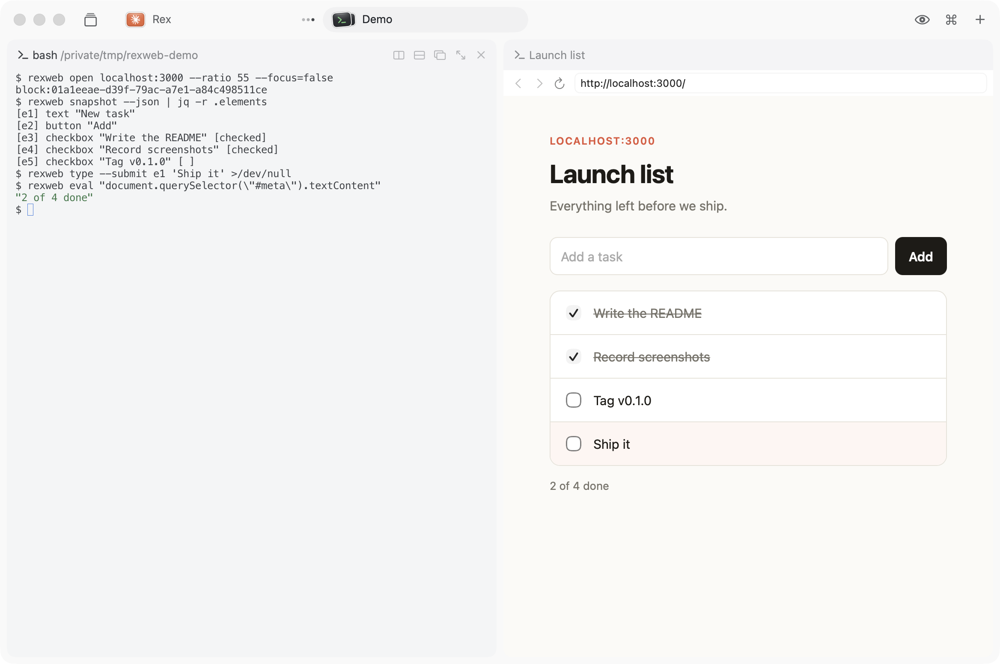

# rexweb

Browser panes for [Rex](https://www.superlogical.com/rex). Real WebKit, the
engine Safari uses, right beside your terminal, and scriptable by you and your
agents.



## Install

You need macOS 14 or later, [Rex](https://www.superlogical.com/rex/docs/installation),
`jq`, and the Xcode command line tools.

```sh
git clone https://github.com/acoyfellow/rexweb
cd rexweb && ./install.sh
```

Run `./install.sh` again to update. `./uninstall.sh` removes everything;
add `--purge` to delete cookies and site data too.

## Use it

Press **`Shift-Cmd-B`** in Rex, or pick **Open Browser Pane** from the command
palette. From a shell:

```sh
rexweb open localhost:3000
rexweb open docs.rs --split=below
rexweb open --tab github.com
```

A browser pane behaves like any other Rex pane. Split it, resize it, zoom it,
move it to another tab, or close it. Its header shows the page's title.

| In a browser pane | |
| --- | --- |
| `Cmd-L` | Address bar |
| `Cmd-R` | Reload |
| `Cmd-[` / `Cmd-]` | Back / forward |
| `Cmd-+` / `Cmd--` / `Cmd-0` | Zoom |
| `Cmd`-click a link | Open it in a new pane |
| `Ctrl-Opt-Arrow` | Back to the Rex pane in that direction |

Right-click and choose **Inspect Element** for Web Inspector.

### Open Rex's links in Rex

```sh
rexweb links on
```

Links you click in Rex now open in a browser pane beside the pane you clicked
in. Links from every other app,
and from `open` in a shell, still go to the browser you had before. This works
by making RexWeb your default browser, which checks where each link came from
and passes the rest on. `rexweb links off` puts your old browser back.

## Drive it from scripts and agents

```sh
$ rexweb snapshot
Launch list
http://localhost:3000/

Elements:
[e1] text "New task"
[e2] button "Add"
[e3] checkbox "Write the README" [checked]

$ rexweb type --submit e1 'Ship it'
$ rexweb eval 'document.querySelector("#meta").textContent'
"2 of 4 done"
```

| Command | |
| --- | --- |
| `nav URL` | Go to a page and wait for it to load |
| `snapshot` | Number the page's controls (`e1`, `e2`, ...) and print its text |
| `click TARGET` | Click `e2` or a CSS selector, with a real mouse click |
| `type TARGET TEXT` | Fill a field; `--clear`, `--submit` |
| `press KEY` | `enter`, `tab`, `escape`, arrows, ... |
| `eval JS` | Run JavaScript, `await` included; prints JSON |
| `wait` | Until `--selector` matches, `--text` appears, or the page loads |
| `screenshot [PATH]` | Save a PNG |
| `back`, `forward`, `reload`, `info`, `ls`, `focus`, `close` | |

Commands act on the browser pane you used last. Pass `-b BLOCK` for another
one, by block ID, ID suffix, or label. Most commands take `--json`, and
`rexweb COMMAND --help` covers the rest.

## Signing in

All browser panes share one profile that survives restarts, so you sign in to
a site once.

**Passkeys and security keys don't work.** macOS only offers them to browsers
Apple has approved, and an app you build yourself isn't one. If your single
sign-on needs a passkey, sign in with Chrome and bring the session over:

```sh
rexweb cookies import --domain example.com --domain idp.example.com --reload
```

macOS asks once for the **Chrome Safe Storage** key. With your identity
provider's session imported, sites that sign in through it work until that
session expires. Leave out `--domain` to import every Chrome cookie.

Sign-in popups open in their own window, so they can hand the result back to
the page.

## Configure

In `~/.config/rex/init.lua`:

```lua
require("rexweb").setup{
  key = "shift+cmd+b",  -- false for no shortcut
  split = "right",      -- right, left, above, or below
  ratio = 0.5,          -- the browser's share of the split
  home = "",            -- a new pane's page; empty focuses the address bar
}
```

`~/.rexweb/config.json` can set `search_url` (with `%s` for the query),
`links` (`"split"`, the default, or `"tab"`), `fallback_browser` (a bundle ID such as
`com.apple.Safari`), and `port`. If a pane ever sits a few points off, `top`, `left`, `right`,
`bottom`, `gap`, and `header` adjust the fit.

## How it works


Rex draws its own panes and can't show a web page in one. So a browser pane is
a terminal pane running `rexweb-pane`, with a borderless WebKit window from
`RexWeb.app` laid over it. RexWeb reads the layout from Rex's API, follows it
with `rex events`, and keeps each window directly above its Rex window, hidden
whenever its pane isn't on screen.

One side effect: clicking into a page makes RexWeb the active app, so Rex's
title bar dims.

## License

MIT. rexweb is a community project. Superlogical doesn't maintain or endorse
it. Thanks to them for Rex, and for the open API that made this possible.
