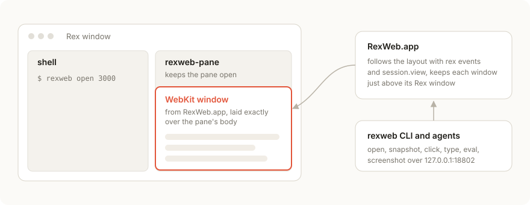

# rexweb

Browser panes for [Rex](https://www.superlogical.com/rex). Each pane is a real
WebKit browser, the engine that Safari uses. It sits beside your terminal.
You and your agents can script it. An optional second app adds
[Chromium panes](#chromium-panes).


## Install

You need:

- macOS 14 or later (Apple silicon or Intel).
- [Rex](https://www.superlogical.com/rex/docs/installation) with a working `rex` command. Check with `rex version`.
- The Xcode command line tools. Check with `xcode-select -p`.
- `jq`.

```sh
git clone https://github.com/acoyfellow/rexweb
cd rexweb && ./install.sh
```

The script asks no questions. It is safe to run again. It does these steps:

1. It checks the requirements. It says how to fix each one that fails.
2. It builds `RexWeb.app` into `~/Applications` and links the `rexweb` command into `~/.local/bin`.
3. It saves the path of `rex` in `~/.rexweb/config.json` as `rex_bin`.
4. It adds `require("rexweb").setup{}` to Rex's `init.lua`. It checks the file with `rex config check`. If the check fails, it restores the backup.
5. It runs `rexweb doctor`.

If `~/.local/bin` is not on your PATH, the script prints the exact line to add.

Do not share a built `RexWeb.app`. It is signed only for your Mac. Build it
from the repo.

To also build the Chromium engine, run `./install.sh --with-chromium`. See
[Chromium panes](#chromium-panes) for what it needs and what it downloads.

### Update

```sh
git pull && ./install.sh
```

Reinstalling restarts RexWeb. Open panes go blank for about 2 seconds. Then
they come back.

If you installed the Chromium engine, update both apps with
`git pull && ./install.sh --with-chromium`. Plain `./install.sh` rebuilds only
`RexWeb.app`.

### Uninstall

```sh
./uninstall.sh
```

If `links` is on, the script turns it off first. macOS asks you to confirm.
Then the script closes browser panes. It removes `RexWeb.app`,
`RexWebChromium.app` if it is installed, the CLI, and the Lua module. Add
`--purge` to also delete `~/.rexweb` and the cookie and site data of both
engines.

## Use it

Press **`Shift-Cmd-B`** in Rex, or pick **Open Browser Pane** from the command
palette. From a shell:

```sh
rexweb open localhost:3000
rexweb open docs.rs --split=below
rexweb open --tab github.com
```

Browser panes show only while their Rex window is open on screen. A browser
pane behaves like any other Rex pane. You can split it, resize it,
zoom it, move it to another tab, or close it. Its header shows the page title.

`rexweb open` prints the block ID of the new pane. Then it waits for the page
to load. If the page fails to load, it still prints the ID. It also writes
`Error: ...` to stderr and exits 1. It warns you if Rex is not showing the
pane. Use `--no-wait` to skip the wait.

| In a browser pane | |
| --- | --- |
| `Cmd-L` | Address bar |
| `Cmd-R` | Reload |
| `Shift-Cmd-R` | Reload without cache |
| `Cmd-[` / `Cmd-]` | Back / forward |
| `Cmd-+` / `Cmd--` / `Cmd-0` | Zoom |
| `Cmd-W` | Close the pane |
| `Shift-Cmd-B` | Open another browser pane beside it |
| `Cmd`-click a link | Open it in a new pane |
| `Ctrl-Opt-Arrow` | Move to the Rex pane in that direction |
| `` Ctrl-Opt-` `` | Back to Rex |

Right-click and choose **Inspect Element** for Web Inspector. In a Chromium
pane, run `rexweb devtools` instead.

### Open Rex's links in Rex

```sh
rexweb links on
```

A person must be at the screen. macOS shows a dialog to confirm the default
browser.

Links that you click in Rex now open in a browser pane beside the pane you
clicked in. Links from other apps, and from `open` in a shell, still go to your
previous browser. RexWeb becomes your default browser. It checks where each
link came from and passes the rest on. `rexweb links off` restores your
previous browser.

`RexWeb.app` is the default browser even if you use Chromium panes. It opens
each link in the engine that the `engine` key names. See
[Configure](#configure).

## Drive it from scripts and agents

```sh
$ id=$(rexweb open --focus=false localhost:3000)
$ rexweb snapshot -b "$id"
Launch list
http://localhost:3000/

Elements:
[e1] text "New task"
[e2] button "Add"
[e3] checkbox "Write the README" [checked]

$ rexweb type -b "$id" --submit e1 'Ship it'
$ rexweb eval -b "$id" 'document.querySelector("#meta").textContent'
"2 of 4 done"
```

| Command | |
| --- | --- |
| `nav URL` | Go to a page and wait for it to load |
| `snapshot` | Number the controls on the page (`e1`, `e2`, ...) and print its text |
| `click TARGET` | Click `e2` or a CSS selector, with a real mouse click |
| `type TARGET TEXT` | Fill a field; `--clear`, `--submit` |
| `press KEY` | `enter`, `tab`, `escape`, arrows, ... |
| `eval JS` | Run JavaScript, `await` included; prints JSON |
| `wait` | Wait until `--selector` matches, `--text` appears, or the page loads |
| `screenshot [PATH]` | Save a PNG |
| `console` | Print console messages and page errors; `--level`, `--since N`, `--clear` |
| `html [SELECTOR]` | Print the live HTML of the page or of one element |
| `network` | Chromium panes only. Print the page's requests; `--failed`, `--since N`, `--clear` |
| `devtools [close]` | Chromium panes only. Open or close Chromium DevTools |
| `cdp METHOD [PARAMS]` | Chromium panes only. Send one Chrome DevTools Protocol command and print the result |
| `back`, `forward`, `reload`, `info`, `ls`, `focus`, `close` | |

Scripts and agents must keep the ID from `open` and pass it with `-b ID`.
Without `-b`, a command acts on the most recently used pane. That pane can
belong to someone else. `-b` also accepts an ID suffix or part of the page title. Most
commands take `--json`. `rexweb COMMAND --help` shows the rest.

`click`, `type`, and `press` need the pane on screen. If it isn't, they fail
after about a second. `snapshot`, `eval`, and `screenshot` work either way.

[AGENTS.md](AGENTS.md) is the guide for coding agents. `rexweb skill` prints
the same guide.

## Chromium panes

rexweb has a second, optional engine. `RexWebChromium.app` draws panes with
Chromium, through the Chromium Embedded Framework (CEF). WebKit and Chromium
panes can be open at the same time.

Use a Chromium pane when you need one of these:

- The browser's own console messages, such as why a CORS request was refused
  or what a Content Security Policy blocked.
- A log of the page's network requests.
- Chromium DevTools, or the Chrome DevTools Protocol.
- A page that only works in Chromium.

WebKit stays the default. It is much smaller, and it plays MP4 video.

### Install the Chromium engine

You need macOS 15 or later and full Xcode, not only the command line tools.
The build uses the Swift Package Manager. Check with `swift package --version`.

```sh
./install.sh --with-chromium
```

The script does the normal install first. Then it builds
`RexWebChromium.app` into `~/Applications`. The first build downloads CEF,
about 134 MB, from `cef-builds.spotifycdn.com`. The installed app takes about
290 MB.

### Use a Chromium pane

```sh
id=$(rexweb open --engine chromium localhost:3000)
rexweb console -b "$id" --level error
rexweb network -b "$id" --failed
rexweb devtools -b "$id"
```

Only `open` needs `--engine`. Every other command finds the app that owns the
pane. `rexweb ls` marks Chromium panes with `[chromium]`. `Cmd`-click on a
link opens a pane with the same engine. To make Chromium the default, set
`"engine": "chromium"` in `~/.rexweb/config.json`.

`rexweb console` prints more for a Chromium pane. The browser's own messages
start with their origin in brackets, such as `[network]` or `[security]`.

`rexweb network` prints each request's number, status, method, type, and URL.
A failed request shows `ERR` and the reason. Each pane keeps its last 1000
requests. Headers and bodies are not kept. `network`, `devtools`, and `cdp`
fail with a clear error on a WebKit pane.

`rexweb cdp` sends one Chrome DevTools Protocol command to the pane and prints
the result as JSON. It covers what the other commands don't, and it needs no
debugging port:

```sh
rexweb cdp -b "$id" Page.getLayoutMetrics
rexweb cdp -b "$id" Emulation.setDeviceMetricsOverride \
  '{"width":390,"height":844,"deviceScaleFactor":3,"mobile":true}'
```

A `-b` value that matches panes in both apps is refused, with the matching
panes listed. Use more of the pane ID.

### The DevTools Protocol port

To drive Chromium panes from your own Chrome DevTools Protocol client, set a
port in `~/.rexweb/config.json`:

```json
{ "chromium_debug_port": 9333 }
```

Then restart the app: `pkill -x RexWebChromium`. The protocol is now at
`http://127.0.0.1:9333`. The port is off by default.

**Turn it on only when you need it.** The port has no password. Any program
on your Mac that can reach it can drive every Chromium pane. That includes
panes that are signed in to your accounts.

### Limits

- MP4 video does not play. Official CEF builds have no H.264 or AAC decoders.
  WebM plays. Use a WebKit pane for MP4.
- `rexweb links on` still makes `RexWeb.app` the default browser, not the
  Chromium app. `RexWeb.app` then opens the link in the engine that you
  configured.
- `RexWebChromium.app` is signed only for your Mac, without a developer
  identity. Because of this, Chromium encrypts its cookies with a fixed key.
  Any process that runs as you can read them. The profile is in
  `~/.rexweb/chromium`.
- Passkeys and security keys do not work, as in WebKit panes.

## Signing in

Each engine has one profile, which all its panes share. It survives restarts.
You sign in to a site once for each engine that you use.

**Passkeys and security keys do not work.** macOS offers them only to browsers
that Apple approves. An app that you build yourself is not one of them. If your
single sign-on needs a passkey, sign in with Chrome. Then bring the session
over:

```sh
rexweb cookies import --domain example.com --domain idp.example.com --reload
```

A person must be at the screen. macOS asks for the **Chrome Safe Storage** key
in a Keychain prompt. After the import of your identity provider's session,
sites that sign in through it work until that session expires. Leave out
`--domain` to import every Chrome cookie.

`cookies import` and `cookies set` write to the profile of the engine that the
`engine` key names, which is WebKit by default. Add `--engine chromium` or
`--engine webkit` to choose.

Sign-in popups open in their own window. This lets them hand the result back to
the page.

## Configure

In `~/.config/rex/init.lua`:

```lua
require("rexweb").setup{
  key = "shift+cmd+b",  -- false for no shortcut
  split = "right",      -- right, left, above, or below
  ratio = 0.5,          -- the browser's share of the split
  home = "",            -- a new pane's page; empty focuses the address bar
  engine = "chromium",  -- "webkit" or "chromium"; leave it out to use config.json
}
```

`engine` here sets the engine for `Shift-Cmd-B` and the palette actions. When
it is left out, they use the `engine` key in `config.json` below, which
defaults to WebKit.

### Layout

RexWeb reads Rex's own settings and follows them. These include the pane style
(comfortable or compact), the toolbar layout and auto-hide, the sidebar, and
the pane headers. Floating panes and full screen work too.

`~/.rexweb/config.json` has these keys:

| Key | Meaning |
| --- | --- |
| `search_url` | Search address. Use `%s` for the query. |
| `links` | `"split"` (default) or `"tab"`. |
| `fallback_browser` | Bundle ID of the browser for other links, such as `com.apple.Safari`. |
| `rex_bin` | Path of the `rex` command. `install.sh` sets it. |
| `port` | Port of the local RexWeb server. Default 18802. |
| `engine` | `"webkit"` (default) or `"chromium"`. The engine for `rexweb open`, the cookie commands, and links that you click in Rex. |
| `chromium_port` | Port of the local RexWebChromium server. Default 18803. |
| `chromium_debug_port` | Port for the Chrome DevTools Protocol. Default 0, which means off. Read [the warning](#the-devtools-protocol-port) first. |

If a pane sits off its place, set `top`, `left`, `right`, `bottom`, `gap`,
`header`, or `radius`. Values are in points. They replace the values that
RexWeb detects.

Restart RexWeb after you edit the file: `pkill -x RexWeb`. If Chromium panes
are open, also run `pkill -x RexWebChromium`.

## Troubleshooting

- Run `rexweb doctor`. It prints one `ok` or `FAIL` line for each check. It exits 1 if any check fails. Fix each `FAIL` line as it says.
- To restart RexWeb, run `pkill -x RexWeb`. Panes come back within 2 seconds.
- To restart the Chromium engine, run `pkill -x RexWebChromium`. `rexweb doctor` checks it only if it is installed.
- If the Rex server restarts, browser panes come back as plain shells. Close them and open new ones.
- If the problem stays, run `./install.sh` again.

## How it works



Rex draws its own panes. It cannot show a web page in one. A browser pane is a
terminal pane that runs `rexweb-pane`. A borderless WebKit window from
`RexWeb.app` lies over it. RexWeb reads the layout from Rex's API and follows
it with `rex events`. It keeps each window directly above its Rex window. It
hides the window when its pane is not on screen.

RexWeb listens on 127.0.0.1 only. Every request needs the token in
`~/.rexweb/token` (mode 600). RexWeb refuses requests from web pages.

`RexWebChromium.app` works the same way with Chromium windows. It has its own
port and shares the token. The `rexweb` command sends each request to the app
that owns the pane.

One side effect: clicking into a page makes RexWeb the active app, so Rex's
title bar dims.

## License

MIT. rexweb is a community project. Superlogical does not maintain or endorse
it. Thanks to them for Rex, and for the open API that made this possible.
